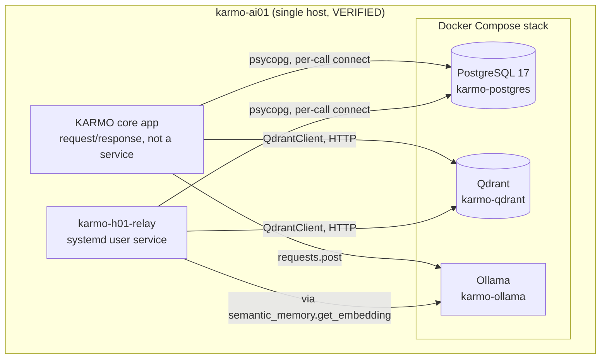
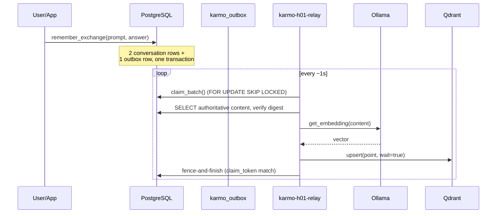
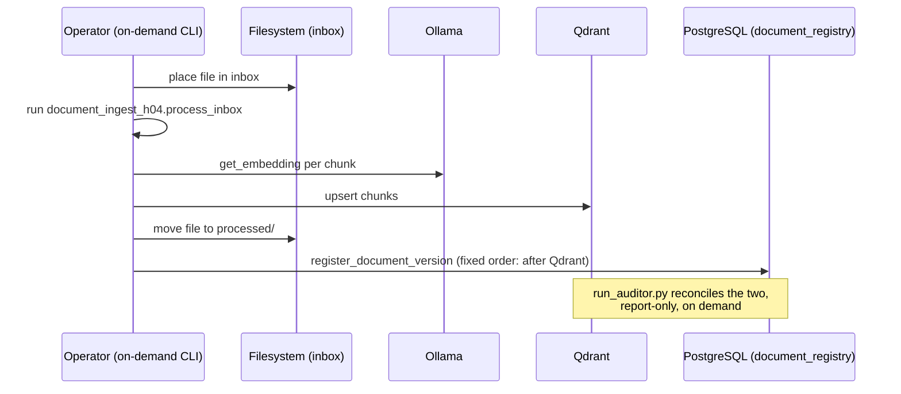

# KARMO Current Architecture Map

Status: descriptive, not prescriptive. Documents the repository **as it
exists now** (post Foundation v1, pre Core v2). Every component below was
read directly this session; nothing is invented. Each entry is labeled
**VERIFIED** (read directly in this repo or confirmed against production
this program period), **INFERRED** (a reasonable conclusion from what was
read, not independently re-run), or **PROPOSED** (this document's own
forward-looking note, not a current fact). Produced under the Core v2
Engineering Blueprint Program, Workstream 1.

## System overview

## Component table

### PostgreSQL

- **PURPOSE**: authoritative structured state — conversation turns,
  outbox events, document registry, tool registry (future, not built).
- **OWNER**: KARMO Core (no domain-specific tables exist yet).
- **INPUTS**: INSERT/UPDATE from every app/relay code path via
  `get_connection()`.
- **OUTPUTS**: rows read back by the same modules; no other consumer.
- **STATE**: `public.conversation_memory`, `public.karmo_memory`,
  `public.karmo_outbox`, `public.document_registry` — **VERIFIED** to
  exist in production (confirmed via read-only query the prior program
  period; row counts: 16 / 1 / 1 / 3 as of 2026-09-09).
- **DEPENDENCIES**: none upstream; every other component depends on it.
- **FAILURE MODES**: connection refused (container down) → every caller's
  `get_connection()` raises immediately, uncaught by any retry wrapper
  except the H0.1 relay's outbox-specific transient-error handling.
  **INFERRED**: a Postgres outage would hard-fail any live document
  ingest/search call with no graceful degradation.
- **AUTHORITY**: I-03 authoritative source for every table it holds.
- **CURRENT CONFIG SOURCE**: hardcoded per-module constants
  (`DEFAULT_HOST = "127.0.0.1"`, `DEFAULT_PORT = "5433"` in
  `h04/app/registry_db.py`; `host="127.0.0.1", port=5433` inline in
  `docs/handoff/h04/memory.py`) — **VERIFIED** duplicated, not
  single-sourced (see Workstream 2).
- **OBSERVABILITY**: none beyond what `docker ps`/`pg_isready` expose
  externally; no query logging, no slow-query tracking **VERIFIED** absent
  from every module read.
- **RECOVERY METHOD**: `h04/app/recovery.py`'s `pg_dump`/`psql`-restore
  drill — **VERIFIED** tested in isolation
  (`test_backup_snapshot_corruption_restore_integrity_workflow`).
  Production backups exist as point-in-time tarballs/dumps under
  `/home/lofason/karmo-ai/hardening/` per cutover records — **VERIFIED**
  from `docs/project-state/CURRENT_STATE.md`, not independently re-tested
  this session.

### Qdrant

- **PURPOSE**: vector retrieval storage for semantic memory and document
  knowledge.
- **OWNER**: KARMO Core.
- **INPUTS**: `.upsert()`/`.set_payload()` from the H0.1 relay and H0.2/H0.4
  ingest modules only.
- **OUTPUTS**: `.scroll()`/`.query_points()` reads from every search/audit
  path.
- **STATE**: collections `karmo_semantic_memory` (5 pts),
  `karmo_documents` (8 pts), `karmo_h00_dense_baseline` (8 pts, frozen) —
  **VERIFIED**, all `status: green`, confirmed the prior program period.
- **DEPENDENCIES**: none upstream.
- **FAILURE MODES**: the H0.1 relay's `_upsert` wraps failures as
  `TransientDeliveryError` (retried); `document_memory.search_documents`
  and `document_ingest`'s per-chunk calls have **no equivalent wrapper**
  — **VERIFIED** (Workstream 4, prior program, finding F6) a live query
  during a Qdrant outage fails outright.
- **AUTHORITY**: vector storage only — PostgreSQL (`document_registry`)
  is the authoritative *expected* state Qdrant's actual state is
  reconciled against for documents; no equivalent registry exists for
  `karmo_semantic_memory`.
- **CURRENT CONFIG SOURCE**: `QDRANT_URL = "http://127.0.0.1:6333"`
  independently redeclared in at least 10 files — **VERIFIED** (see
  Workstream 2).
- **OBSERVABILITY**: collection `status`/`points_count` via the HTTP API
  (used ad hoc this session); no application-level metrics.
- **RECOVERY METHOD**: `recovery.py`'s native Qdrant snapshot
  create/list/recover — **VERIFIED** tested in isolation.

### Ollama / embedding layer

- **PURPOSE**: produces the vector embeddings both Qdrant collections
  store.
- **OWNER**: KARMO Core, single shared dependency across every domain that
  will ever need embeddings.
- **INPUTS**: text (`get_embedding(text)`).
- **OUTPUTS**: a fixed-length float vector (768-dim, `embeddinggemma`
  model — **VERIFIED** in `docs/handoff/h03/semantic_memory.py`).
- **STATE**: stateless per call; the model itself is loaded by the Ollama
  container.
- **DEPENDENCIES**: none upstream (a local, single-host model server).
- **FAILURE MODES**: `get_embedding` has no retry/circuit-breaker at the
  call site — **VERIFIED** (Workstream 4, prior program, finding F6).
  `outbox.py`'s `_embedding` additionally validates vector shape
  (dimension, all-finite) before use, converting a bad response into
  `PermanentDeliveryError("embedding_dimension_mismatch")` — a real,
  useful fail-closed check, but only present in that one caller.
- **AUTHORITY**: not a data-authority concern (no persistent state of its
  own); a **model-identity** concern — **VERIFIED** no embedding-model
  provenance is recorded on `karmo_semantic_memory` points at all
  (Workstream 4, prior program, finding F4).
- **CURRENT CONFIG SOURCE**: `OLLAMA_EMBED_URL = "http://127.0.0.1:11434/api/embed"`,
  `EMBED_MODEL = "embeddinggemma"` — hardcoded, single location in
  `semantic_memory.py`, but the *URL host/port* pattern is the same
  duplicated-constant issue as Postgres/Qdrant in every other module.
- **OBSERVABILITY**: none — no latency/failure metric anywhere.
- **RECOVERY METHOD**: none exists or is needed (stateless; container
  restart alone is recovery, container status confirmed healthy this
  program period).

### Semantic memory (H0.1)

- **PURPOSE**: durable, retry-safe promotion of user-prompt conversation
  turns into `karmo_semantic_memory` for later semantic recall.
- **OWNER**: KARMO Core.
- **INPUTS**: `remember_exchange(prompt, answer)` (atomic DB write) →
  outbox event → `OutboxRelay.process_once` (async delivery).
- **OUTPUTS**: one Qdrant point per delivered event; outbox row transitions
  to `delivered`/`dead`.
- **STATE**: `public.karmo_outbox` (queue), `public.conversation_memory`
  (source of truth for content), `karmo_semantic_memory` (derived,
  eventually-consistent).
- **DEPENDENCIES**: PostgreSQL, Qdrant, Ollama.
- **FAILURE MODES**: **VERIFIED** (this program, Workstream 4 finding F8)
  the relay's generic-exception retry path bounds delay (cap 3600s) but
  not attempt *count* — an unanticipated bug retries hourly forever
  rather than eventually dead-lettering. Concurrency/crash-recovery
  (`FOR UPDATE SKIP LOCKED` + claim-token fencing) is genuinely solid —
  **VERIFIED** by the frozen H01-T08/T09/T11/T12 failure-matrix tests.
- **AUTHORITY**: I-04 idempotency by construction — deterministic UUID5
  event identity (`event_id_for_user_id`), fenced completion
  (`WHERE claim_token = %s AND status = 'processing'`).
- **CURRENT CONFIG SOURCE**: `DEFAULT_QDRANT_URL`, `DEFAULT_VECTOR_SIZE = 768`
  hardcoded in `outbox.py`.
- **OBSERVABILITY**: `last_error_code`/`last_error` per outbox row —
  I-07-shaped, but only queryable directly via SQL, no surfaced dashboard.
- **RECOVERY METHOD**: retry is the recovery mechanism by design; no
  separate backup path beyond PostgreSQL's own.

### Document memory / document ingestion (H0.2, H0.4)

- **PURPOSE**: durable, versioned knowledge base with active/superseded
  lifecycle and cross-store integrity guarantees.
- **OWNER**: KARMO Core.
- **INPUTS**: files placed in an inbox directory (production path, not in
  this repo) → `document_ingest_h04.process_inbox` → Docling conversion +
  chunking + embedding → Qdrant upsert → `document_registry` write.
- **OUTPUTS**: `karmo_documents` points (H0.2 lifecycle payload shape);
  `public.document_registry` rows (H0.4 authoritative expected state).
- **STATE**: `document_registry` is authoritative; Qdrant is derived,
  reconciled against it by the auditor.
- **DEPENDENCIES**: PostgreSQL, Qdrant, Ollama, Docling (a hard import,
  no fallback — **VERIFIED**, a real, if low-probability,
  single-point-of-failure/dependency-coupling: no ingest can happen at all
  if Docling is unavailable or its API changes incompatibly).
- **FAILURE MODES**: write ordering is fixed and one-directional
  (convert → Qdrant upsert → archive move → registry write); a registry
  write failure after Qdrant succeeds leaves an `ORPHAN_VECTOR`, reported
  loudly ("INTEGRITY INCOMPLETE / REGISTRY FAILED"), never silently —
  **VERIFIED** by direct code read and by tonight's own production audit
  finding exactly two such orphans (the already-known ambiguous
  `karmo-v05-new.html` hashes).
- **AUTHORITY**: I-03 — `document_registry` is explicitly the
  authoritative expected-state record; Qdrant's actual state is checked
  against it, never the reverse.
- **CURRENT CONFIG SOURCE**: hardcoded `QDRANT_URL`,
  `PROCESSED`/`INBOX`/`FAILED` absolute host paths in
  `document_ingest_h04.py`.
- **OBSERVABILITY**: print-based console output only (`REGISTERED IN
  DOCUMENT_REGISTRY`, `INTEGRITY INCOMPLETE`, etc.) — **VERIFIED** no
  structured logging anywhere in this module.
- **RECOVERY METHOD**: `run_auditor.py` (detection) +
  `bootstrap_legacy_registry.py`/`registry_repair.py` (repair, both
  report-only by default, `--apply` gated) + `recovery.py` (backup/restore
  drill).

### Integrity / auditing (H0.4)

- **PURPOSE**: report-only cross-store reconciliation between
  `document_registry` (expected) and Qdrant (actual).
- **OWNER**: KARMO Core.
- **INPUTS**: `document_registry` rows + Qdrant points (read-only).
- **OUTPUTS**: a flat finding list (`MISSING_ARCHIVED_FILE`,
  `ARCHIVED_FILE_HASH_MISMATCH`, `MISSING_VECTOR`, `DUPLICATE_VECTOR`,
  `INCORRECT_EXPECTED_CHUNK_COUNT`, `ORPHAN_VECTOR`,
  `MULTIPLE_ACTIVE_VERSIONS`, `ACTIVE_STATE_MISMATCH`,
  `PROVENANCE_MISMATCH`, `LEGACY_PROVENANCE_UNVERIFIED`).
- **STATE**: stateless — computed fresh every run.
- **DEPENDENCIES**: PostgreSQL, Qdrant, filesystem (archived files).
- **FAILURE MODES**: none of its own — a connection/setup error exits
  nonzero via a normal traceback, distinct from "findings present"
  (`run_auditor.py`'s own documented distinction).
- **AUTHORITY**: strictly READ — proven report-only by
  `test_auditor_is_report_only`'s write-call-injection technique;
  `check_active_version_state`'s Qdrant-active definition was corrected
  this program period (PR #15, not yet merged) to match
  `document_memory.py`'s own documented definition.
- **CURRENT CONFIG SOURCE**: `run_auditor.py`'s own `QDRANT_URL` constant.
- **OBSERVABILITY**: this module *is* KARMO's observability surface for
  document integrity — its own output has no further wrapper.
- **RECOVERY METHOD**: N/A — detection only; repair is a separate tool.

### Recovery (H0.4)

- **PURPOSE**: backup/restore for PostgreSQL and Qdrant.
- **OWNER**: KARMO Core.
- **INPUTS**: `pg_dump`, Qdrant's native snapshot API.
- **OUTPUTS**: a dump file / a named snapshot.
- **STATE**: stateless orchestration over the underlying stores' own
  backup primitives.
- **DEPENDENCIES**: `docker exec` (isolated tests) / direct host access
  (production, per `COMMAND_LOG.md`'s cutover record).
- **FAILURE MODES**: `verify_backup_file` performs a minimal structural
  check of the dump — **VERIFIED**, not a full restore-and-diff
  verification (a restore drill *is* performed in the isolated test, but
  production backups are not automatically re-verified by restoring them
  — **INFERRED** gap, consistent with Workstream 8's threat model).
- **AUTHORITY**: N/A — operational tooling, not a data authority.
- **CURRENT CONFIG SOURCE**: container name (`karmo-postgres`) passed as a
  parameter, not hardcoded — the one module in this review that avoids
  the constant-duplication pattern.
- **OBSERVABILITY**: print statements only.
- **RECOVERY METHOD**: is itself the recovery method for every other
  component's PostgreSQL/Qdrant data.

### Configuration (cross-cutting)

- **PURPOSE**: none — this is the *absence* of a component, documented
  because Workstream 2 exists to fix it.
- **CURRENT STATE**: **VERIFIED** no single configuration module exists
  anywhere in the codebase; every module independently declares its own
  host/port/URL/collection-name constants. Full inventory in Workstream
  2's deliverable.

### Governance

- **PURPOSE**: the permanent rule set every other component must comply
  with (I-01–I-09, the Mandatory Phase Invariant Impact Review, the
  Mandatory Project Save Completion Rule, the Mandatory Production Access
  Authorization Gate).
- **OWNER**: Natalie (approval authority); `docs/governance/` (canonical
  location).
- **INPUTS**: explicit governance-change approval from Natalie only.
- **OUTPUTS**: the compliance obligation every phase/workload/session
  operates under.
- **STATE**: `docs/governance/KARMO_ENGINEERING_INVARIANTS.md`,
  `KARMO_AUTONOMOUS_EXECUTION_CONTRACT.md`, `KARMO_VALIDATION_LADDER.md` —
  **VERIFIED** current on `main` as of this session (Production Access
  Authorization Gate PR #12 already merged; no other governance PR open).
- **DEPENDENCIES**: none — this is the root of the dependency graph, not
  a leaf.
- **FAILURE MODES**: N/A.
- **AUTHORITY**: absolute, by every other document's own explicit
  precedence statement.
- **CURRENT CONFIG SOURCE**: N/A.
- **OBSERVABILITY**: every governance change is itself required to
  produce an Invariant Impact Review and a PROJECT SAVE record — the
  audit trail is the governance documents' own history plus
  `docs/project-state/CHANGE_LOG.md`.
- **RECOVERY METHOD**: `git revert` — every governance change to date has
  been an ordinary, reversible commit.

### Spec Kit

- **PURPOSE**: prospective workflow tooling for future phases
  (`/speckit-specify` → `/speckit-plan` → `/speckit-tasks` →
  `/speckit-implement`), explicitly subordinate to the governance
  documents above.
- **OWNER**: whoever runs a future phase through it; adopted, not yet
  exercised for a real feature.
- **STATE**: **VERIFIED** initialized (`.specify/`, `.claude/skills/
  speckit-*`, PR #9 merged 2026-09-09); one proposal artifact exists
  (`specs/001-tool-capability-registry/spec.md`, explicitly marked
  PROPOSAL, not an approved feature).
- **DEPENDENCIES**: none technical; governs its own workflow only.
- **FAILURE MODES**: N/A — tooling, not a runtime component.
- **AUTHORITY**: none of its own — its constitution
  (`.specify/memory/constitution.md`) explicitly subordinates it to the
  invariants document.
- **CURRENT CONFIG SOURCE**: N/A.
- **OBSERVABILITY**: N/A.
- **RECOVERY METHOD**: N/A.

### Services / process boundaries

- **PURPOSE**: documents what actually *runs continuously* vs. what runs
  on demand.
- **STATE (VERIFIED, this program period)**:
  - `karmo-h01-relay` — systemd **user** service, `lofason`, continuous
    polling loop (`--loop`), the **only** always-on KARMO-authored
    process.
  - `karmo-postgres`, `karmo-qdrant`, `karmo-ollama` — Docker containers,
    always-on infrastructure, not KARMO-authored code.
  - Document ingest, the H0.4 auditor, the legacy-bootstrap/repair tools —
    all **on-demand CLI invocations**, not services. No cron, no
    scheduled job exists anywhere in the current architecture —
    **VERIFIED**, matching `CLAUDE.md`'s standing prohibition on new
    autonomous schedules without explicit approval.
  - The "app" itself (`karmo.py`, `router.py`) — **INFERRED** a
    request/response process (not read in full this session — out of
    this program's scope, referenced only as the caller of
    `document_memory`/`semantic_memory`), not confirmed to be a
    long-running service vs. invoked per-interaction.
- **PROCESS ISOLATION**: **VERIFIED** every process (relay included)
  connects to PostgreSQL/Qdrant independently, with no shared connection
  pool or IPC between them — each is its own OS process with its own
  short-lived DB connections.

## Cross-component data flow

## What this map deliberately does not cover

- The main conversational app (`karmo.py`/`router.py`) internals — out of
  this program's scope; referenced only where it's a caller of the
  memory/document modules already mapped.
- H0.3 (hybrid retrieval) — explicitly NO-PROMOTION, not part of the live
  architecture.
- Any future domain (Voice, Media, BloomBoss, KarmoLab, Personal
  Productivity, Finance) — covered by the readiness specs (Workstreams
  9–11), not this current-state map.
